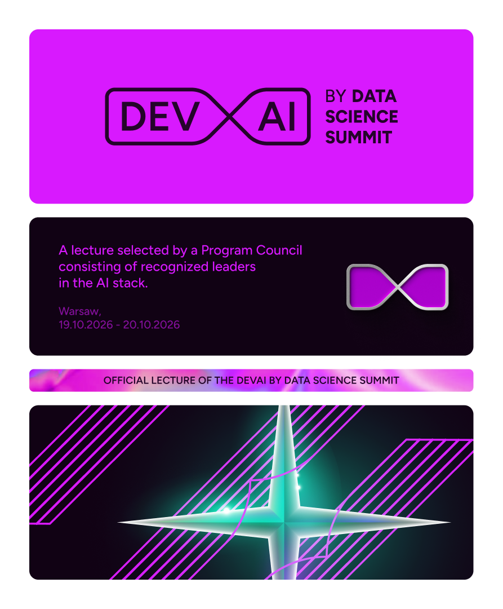
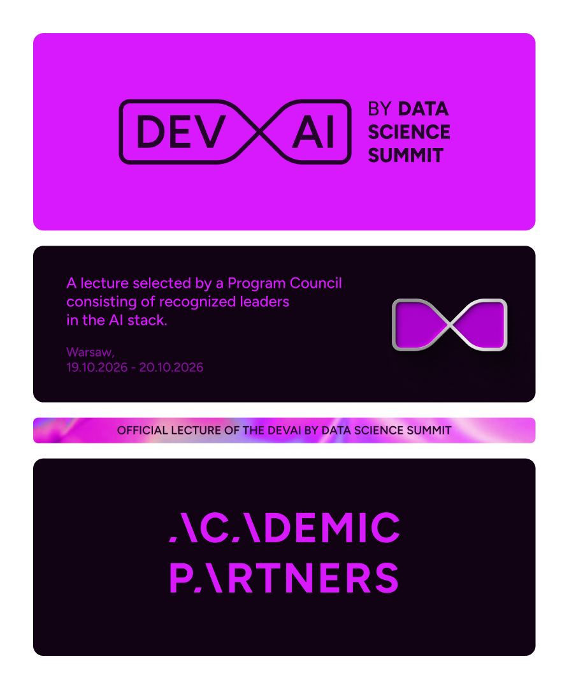

<!-- _class: brand -->
<!-- _footer: "Event organized by: Academic Partners Foundation" -->

<div class="brand-copy">
  <h1>When AI Agents<br>Fail in Production</h1>
  <p class="brand-desc">Tracing, Budgets, and Tool Execution Ledgers</p>
</div>
<div class="brand-person">
  <p class="brand-name">Mikalai Saskavets</p>
  <p class="brand-role">Python &amp; GenAI Engineer, Coherent Solutions</p>
</div>


---

<div class="incident">Incident · Customer B</div>

## One task reached 25 repair rounds

<div class="timeline">
  <div class="time">Intent</div><div class="event">Adapt a core commission fix to Customer B</div>
  <div class="time">Round 1</div><div class="event warn-event">The refund test fails after the first patch</div>
  <div class="time">Round 25</div><div class="event danger-event">The same refund test still fails</div>
  <div class="time">Result</div><div class="event">Operator cancels. No validated change or draft PR.</div>
</div>

---

## The work crossed divergent customer versions

| Planning scale | Workload assumption |
|---|---|
| 54 enterprise customers | About 540 customer service instances |
| 12 core changes each month | 18 candidate implementations per change |
| 12 × 18 | 216 potential tasks each month |

<div class="rail">A candidate task may end in a PR, a no-op, or a human escalation.</div>

---

## One commission fix had different code paths

| Customer version | Where the behavior lived |
|---|---|
| A | Original calculation function |
| B | A workflow engine with REVERSAL events |
| C | A different order data model |
| E | The affected feature was not used |

<p class="small muted">The core fix excluded refunded orders from earned commission.</p>

---

## The campaign carried a change specification

<div class="two-col">
  <div class="card"><h3>Core evidence</h3><p>Source commit, bug description, and regression test for refunded orders.</p></div>
  <div class="card"><h3>Target context</h3><p>Repository, pinned commit, owning team, known customer rules, and exclusions.</p></div>
</div>

<div class="rail">One task represented one candidate customer implementation.</div>

---

## Customer B encoded refunds as REVERSAL

<pre><code>Expected: refunded orders earn no commission
Target rule: refunds use flow='REVERSAL'
Wrong patch: checks kind='refund' instead
Check: Customer B's focused Python tests
</code></pre>

<div class="quote">The wrong field left the refund bug in place.</div>

---

## The worker boundary for tools and GitHub writes

<div class="flow">
  <div class="node">Change<br>task</div><div class="arrow">→</div>
  <div class="node">Celery<br>queue</div><div class="arrow">→</div>
  <div class="node accent-node">Python<br>worker</div><div class="arrow">→</div>
  <div class="node">Patch and<br>pytest</div><div class="arrow">→</div>
  <div class="node warn-node">Draft PR<br>if valid</div>
</div>

<p class="small">Reference design: GPT-4.1 proposes edits; Python validates tools, limits runs, and owns GitHub App actions.</p>

---

<div class="incident">Selected incident rounds · Customer B</div>

## The same failure survived each patch

| Round | Worker action | Focused pytest result |
|---|---|---|
| 1 | First workflow patch | 1 failed |
| 5 | Another patch | 1 failed, same test |
| 12 | Another patch | 1 failed, same test |
| 25 | Another patch | 1 failed, same test |

<div class="rail">Twenty-five test runs were not twenty-five units of progress.</div>

---

## The test artifact showed repeated behavior

<pre><code>Focused Customer B test suite
exit_code: 1
failed_ids: test_refund_has_zero_commission
failure_group: refund_has_zero_commission
patch_round: 12
</code></pre>

---

## A completion message could hide the failed checks

<div class="two-col">
  <div class="card warn-card"><h3>Representative agent summary</h3><p>"Updated the workflow. Ready for review."</p></div>
  <div class="card danger-card"><h3>Worker evidence</h3><p>Last pytest exit code: 1.<br>The refund test still failed.<br>No draft PR created.</p></div>
</div>

<div class="quote">The platform reported the tool result, not the model's confidence.</div>

---

## The review joined four records by run ID

| Question | Evidence to join |
|---|---|
| What was requested? | Change specification and target commit |
| What happened? | Trace and captured pytest artifacts |
| What was allowed? | Tool execution ledger with policy decisions |
| What was consumed? | Budget account across attempts |

<!-- <p class="small muted">GitHub state answered a fifth question: whether any PR was published.</p> -->

---

## A thin trace could not show repetition

<div class="two-col">
  <div class="card warn-card"><h3>Earlier span</h3><p>shell.execute<br>duration: 18 s<br>status: OK</p></div>
  <div class="card good-card"><h3>Useful span</h3><p>round: 12<br>patch hash: p12<br>pytest exit: 1<br>failure group: refund_has_zero_commission</p></div>
</div>

<div class="rail">An OK tool span meant the command ran; it did not mean the tests passed.</div>

---

## The tool ledger recorded authorization and result

<pre><code>run_id: case-B-25      round: 12
tool: test_runner      command: focused Customer B suite
policy: ALLOW          executed: true
exit_code: 1           output_artifact: test-B-12
target_commit: b72f... patch_hash: p12
</code></pre>

<p class="small muted">Representative ledger record.
 </p>

---

## A denied request still belonged in the ledger

<pre><code>run_id: policy-probe-1
tool: shell
operation: pip install unknown-package
policy_decision: denied
executed: false
</code></pre>

<div class="rail">The local allowlist rejected and recorded the request without running it.</div>

---

## The loop passed every local gate

<div class="timeline">
  <div class="time">Model call</div><div class="event">Within its individual request limit</div>
  <div class="time">Patch</div><div class="event">Applied inside the disposable workspace</div>
  <div class="time">Pytest</div><div class="event">Command completed and produced a result</div>
  <div class="time">Missing gate</div><div class="event danger-event">No check for repeated failure without progress</div>
</div>

<br>
<div class="quote">The runtime counted calls, but it did not compare their outcomes.</div>

---

## Three unchanged failures stopped the revised run

```python
if same_failure_signature and no_new_tests_pass:
    no_progress_streak += 1
else:
    no_progress_streak = 1
if no_progress_streak >= 3:
    stop("NO_PROGRESS_LIMIT_EXCEEDED")
```

<p class="small muted">The first failed round counted as one. A bigger diff did not count as progress.</p>

---

## The local reproduction stopped after three repeats

| Local check | Observed result |
|---|---|
| Customer B test | Expected 0.0, got 7.5 |
| Candidate patches | Three distinct patches check wrong fields |
| Repeated signature | One pass, one same failure each round |
| Stop reason | NO_PROGRESS_LIMIT_EXCEEDED |

---

## The low average hid the higher costs

<div class="equation">216 potential tasks × $5 each = $1080</div>

<p class="center">&nbsp;</p>

<div class="quote">A few large repositories or repair loops can break that average.</div>

---

## The budget account followed the task

<div class="timeline">
  <div class="time">Before call</div><div class="event">Reserve estimated tokens or tool time atomically</div>
  <div class="time">After call</div><div class="event">Settle actual consumption and release unused reserve</div>
  <div class="time">At a limit</div><div class="event warn-event">Record BUDGET_EXCEEDED and block new work</div>
</div>

<!-- <div class="rail">Local budget check: a four-unit cap granted 2 + 2, then denied 2. Concurrency remains untested.</div> -->

---

## Customer B ended as a handoff, not a PR

<div class="two-col">
  <div class="card warn-card"><h3>Controlled run state</h3><p>NO_PROGRESS_LIMIT_EXCEEDED</p><p class="small">No validated patch and no draft PR.</p></div>
  <div class="card good-card"><h3>Proposed owner handoff</h3><p>Last diff, target commit, failing tests, trace, ledger, and consumed budget.</p></div>
</div>

<br>
<div class="quote">The controlled run leaves a bounded problem with evidence.</div>

---

## A draft PR began the human change path

<div class="flow">
  <div class="node">Draft PR</div><div class="arrow">→</div>
  <div class="node accent-node">Ready for<br>review</div><div class="arrow">→</div>
  <div class="node">PR checks<br>and owner review</div><div class="arrow">→</div>
  <div class="node good-node">Human<br>merge</div><div class="arrow">→</div>
  <div class="node">Deploy</div>
</div>

<div class="rail">Runtime policy guarded work before review. GitHub rules guarded merge.</div>

---

## One 18-target campaign had six outcomes

| Campaign outcome | Targets |
|---|---:|
| Validated draft PR | 9 |
| Already fixed | 3 |
| Not affected | 2 |
| Human adaptation needed | 2 |
| Budget exceeded | 1 |
| Test environment unavailable | 1 |

<div class="rail">Nine draft PRs were review work, not nine deployed fixes.</div>

---

## The campaign record separated three milestones

<div class="three-col">
  <div class="card"><h3>Agent execution</h3><p>Patch checked, no-op, or explicit stop.</p></div>
  <div class="card"><h3>Code acceptance</h3><p>Owner review and merge of the current commit.</p></div>
  <div class="card"><h3>Customer rollout</h3><p>Release and production verification.</p></div>
</div>

<p class="small muted">Draft PRs still require merge, release, and production verification.</p>

---

## Customer C exposed a different limit

<div class="two-col">
  <div class="card good-card"><h3>Ordinary tests</h3><p>Two pass in the representative Customer C variant.</p></div>
  <div class="card warn-card"><h3>Customer invariant</h3><p>One additional test catches a lost VIP adjustment.</p></div>
</div>

<div class="rail">The customer-specific check blocks a draft PR for Customer C.</div>

---

## Publishing had its own uncertain result

<div class="two-col">
  <div class="card"><h3>Branch push</h3><p>Check the remote branch and expected commit after a lost response.</p></div>
  <div class="card warn-card"><h3>Draft PR create</h3><p>Check open and closed PRs for the known head branch after a lost response.</p></div>
</div>

<div class="rail">The worker held the action as UNKNOWN until reconciliation.</div>

---

## Two failures need different controls

<div class="two-col">
  <div class="card danger-card"><h3>Customer B repair loop</h3><p>The same refund test fails after changed patches.</p><p>Compare results across attempts; stop and hand off when the work makes no progress.</p></div>
  <div class="card warn-card"><h3>Lost GitHub response</h3><p>A branch push or PR create may have succeeded.</p><p>Keep its action key and check GitHub before another write.</p></div>
</div>

<div class="rail">Progress checks govern patch attempts. Reconciliation governs uncertain GitHub writes.</div>
<p class="small muted">The GitHub timeout is a separate recovery scenario.</p>

---

<!-- _class: brand brand-end -->
<!-- _footer: "Event organized by: Academic Partners Foundation" -->

<div class="brand-copy">
  <h1>Thank you for<br>watching!</h1>
  <p class="brand-desc">Remember to leave your questions<br>and rate the presentation<br>in the section below.</p>
</div>


