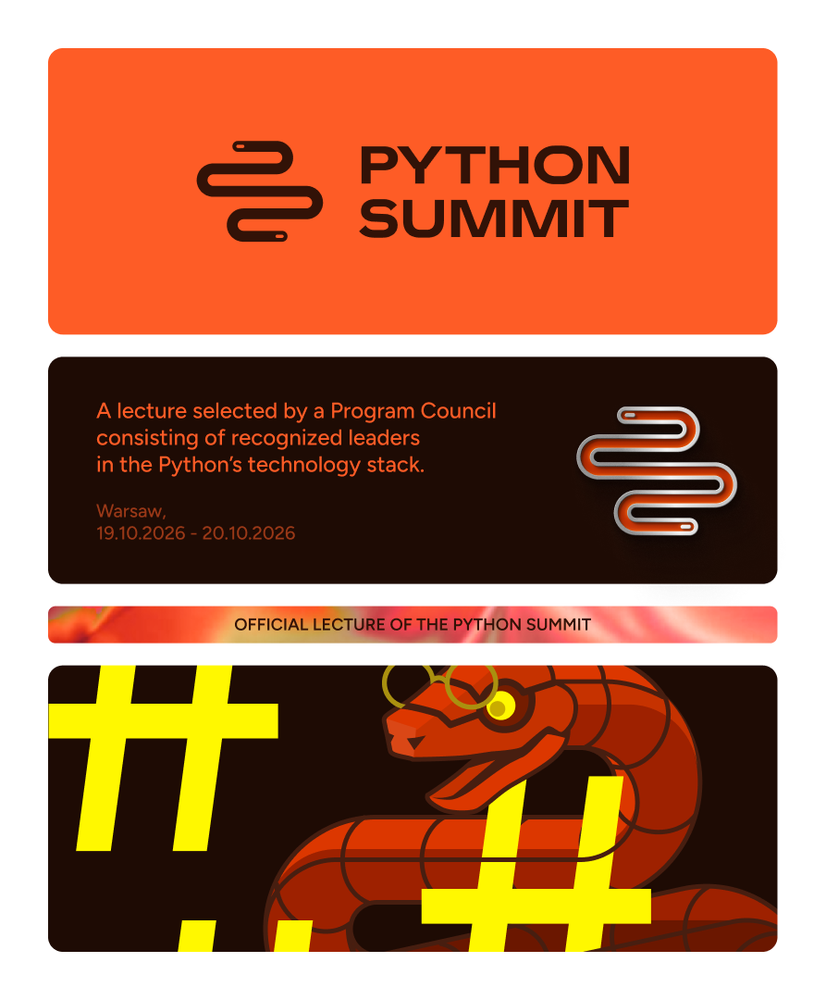
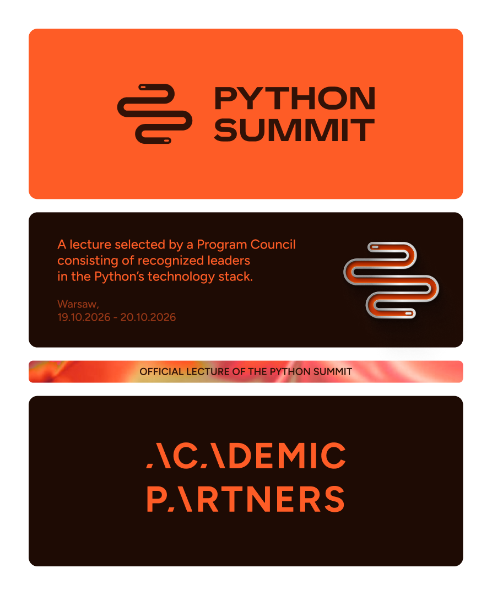

<!-- _class: brand -->
<!-- _footer: "Event organized by: Academic Partners Foundation" -->

<div class="brand-copy">
  <h1>AgentOps<br>in Python</h1>
  <p class="brand-desc">Trace, Bound, and Audit AI Agent Runs Before They Fail</p>
  <p class="brand-name">Mikalai Saskavets</p>
  <p class="brand-role">Python &amp; GenAI Engineer, Coherent Solutions</p>
</div>


---

## One core fix, many customer implementations

<p class="big">A core service changed → Need to deliver changes to customers' copies.</p>

<div class="timeline">
  <div class="time">core team</div><div class="event">Fix a commission calculation in the reference Python service</div>
  <div class="time">client teams</div><div class="event">Own customer workflows, tests, release dates, and business exceptions</div>
  <div class="time">worker</div><div class="event">Investigate applicability, adapt the fix, and prepare review evidence</div>
</div>

<p class="small muted">The copied services reflect years of customer-specific changes.</p>

---

## The task volume

<div class="rail">
  54 customers · about 540 microservices instances ⥤ 
  <br><br>
  12 changes × 18 targets = 
  <br><br>
  <big>216 candidate tasks per month</big>
</div>

<p class="small muted"><br><br>One candidate may produce a draft PR, a documented no-op, or an escalation.</p>

---

## The same intent needs different patches

| Target | Location of commission logic | Possible result |
|---|---|---|
| Customer A | Invoice-shaped Python calculation | Adapt the core test and patch |
| Customer B | Workflow step with a different refund state | Inspect the workflow and adapt the condition |
| Customer C | Different data model | Requires a different adaptation |
| Customer E | Feature not used | Record NOT_APPLICABLE |

<p class="small muted">A clean cherry-pick would not establish equivalent behavior.</p>

---

## Customer B received a clear task

<div class="two-col">
  <div class="card"><h3>Core intent</h3><p class="small">Exclude a fully refunded order from base commission.</p><p class="small">Core commit and regression test identify the change.</p></div>
  <div class="card"><h3>Customer representation</h3><p class="small">A refund uses <code>flow='REVERSAL'</code>.</p><p class="small">Client engineers own the final interpretation.</p></div>
</div>

<div class="rail">Input: core change ID, target commit, allowed paths, test commands, owner</div>

---

## The worker owned the execution path

<div class="flow">
  <div class="node">Task registry</div><div class="arrow">→</div>
  <div class="node">Celery</div><div class="arrow">→</div>
  <div class="node accent-node">Python worker</div><div class="arrow">→</div>
  <div class="node">Draft PR or escalation</div>
</div>

<p>Proposed worker: isolated checkout, model calls, patch application, local checks, trace spans, budget decisions, tool records.</p>
<p class="small muted">Reference architecture: GPT-4.1, Celery, RabbitMQ, PostgreSQL, GitHub App, OpenTelemetry.</p>

---

<!-- _class: adapter-slide -->

## The patch loop around Customer B

```python
assert MAX_PATCH_ATTEMPTS > 0
last_test = None
for attempt in range(MAX_PATCH_ATTEMPTS):
    evidence = read_allowed_files(worktree)
    patch = model.propose_patch(task, evidence, last_test)
    validate_paths(patch, allowed_paths)
    apply_patch(worktree, patch)
    last_test = run_pytest(worktree, deadline)
    if last_test.passed:
        return checked_commit(worktree)
return escalate(last_test)
```

<p class="small warn">The model proposes code. Python enforces path scope and owns every tool call.</p>

---

## Customer B kept failing the same test

<div class="timeline">
  <div class="time nobr">attempt 1</div><div class="event warn-event">Patch checked <code>kind='refund'</code>; pytest still saw commission 7.5</div>
  <div class="time nobr">attempt 2</div><div class="event warn-event">Another patch; same failing test and no new tests passed</div>
  <div class="time nobr">attempt 3</div><div class="event warn-event">Another patch; same failure signature</div>
  <div class="time">early design</div><div class="event danger-event">Without a progress check, retries could continue to the attempt cap</div>
</div>

---

## One run ID connects the evidence

```python
run_id = run-1842       core_change = core-fix-17
attempt 1: patch 26e019...  1 pass, 1 fail
attempt 2: patch 983444...  1 pass, 1 fail
attempt 3: patch 18bb4a...  1 pass, 1 fail
failure: test_refund_has_zero_commission
         expected 0.0, got 7.5
result: NO_PROGRESS_LIMIT_EXCEEDED; draft PR = false
```

---

## The span tree shows the loop

```python
propagate run-1842
  checkout customer-b
  attempt 1: model.call → patch.apply → test.run
  attempt 2: model.call → patch.apply → test.run
  attempt 3: model.call → patch.apply → test.run
  stop: NO_PROGRESS_LIMIT_EXCEEDED
```

<p class="small">Span attributes: run ID, change ID, target commit, attempt, tool, exit code, failure signature.</p>
<p class="small muted">Proposed OpenTelemetry layout.</p>

---

## The third repeated failure changed the decision

<div class="rail">same failure set + no newly passing tests for 3 attempts → NO_PROGRESS_LIMIT_EXCEEDED</div>

```python
if same_failure_streak >= 3 and newly_passing_tests == 0:
    stop_run("NO_PROGRESS_LIMIT_EXCEEDED")
    preserve(patches, pytest_results, trace_id)
    route_to_customer_owner(task)
```

---

## The budget was reserved before each step

| Limit | Worker decision for Customer B |
|---|---|
| Model calls and tokens | Reserve estimated headroom before the next request |
| Pytest runtime | Start only if its deadline fits inside the run deadline |
| Patch attempts | Stop at the configured maximum |
| Campaign budget | Do not start another target when the shared cap is exhausted |

---

## Customer B stopped with evidence

<div class="rail">NO_PROGRESS_LIMIT_EXCEEDED</div>

<div class="timeline big-one">
  <div class="time">reproduced failure</div><div class="event">Three patch hashes, the repeated test result, and a stop event</div>
  <div class="time">owner handoff</div><div class="event">Include target commit, patch diffs, protected output, and trace ID</div>
  <div class="time">task state</div><div class="event">Customer B stays pending for its client engineer; no draft PR</div>
</div>

---

## Customer A passed its local checks

<div class="timeline big-one">
  <div class="time">adaptation</div><div class="event">The invoice-shaped variant contains the core refund fix</div>
  <div class="time">local checks</div><div class="event">Two tests passed on the representative variant</div>
  <div class="time">PR decision</div><div class="event">Passing checks make the change a candidate for a draft PR</div>
  <div class="time">review path</div><div class="event">Push a checked branch, create a draft PR, then request owner review</div>
</div>

<p class="small muted"><br>Passing tests provide limited evidence for a future PR.</p>

---

## Customer C needed a deeper test

<p class="big">Two ordinary tests passed. The customer invariant test failed.</p>

<div class="two-col">
  <div class="card"><h3>Patch evidence</h3><p class="small">The core refund behavior looked correct under ordinary tests.</p></div>
  <div class="card"><h3>Customer rule</h3><p class="small">An additional test detected a lost VIP adjustment.</p></div>
</div>

<p class="small muted">The customer-specific check blocks a draft PR for Customer C.</p>

---

## The campaign was more than a PR count

| Outcome across 18 targets | Count |
|---|---:|
| Validated draft PR | 9 |
| Already had equivalent fix | 3 |
| Not affected | 2 |
| Needs client engineer | 2 |
| Budget exceeded | 1 |
| Test environment unavailable | 1 |
| TOTAL | 18 |

---

## The stopped task changed campaign state

<div class="timeline">
  <div class="time">Customer B</div><div class="event warn-event">NEEDS_HUMAN_INTERVENTION; no PR and no release claim</div>
  <div class="time">Customer A</div><div class="event">Local checks passed; PR_CREATED requires a draft confirmed by GitHub</div>
  <div class="time">campaign</div><div class="event">Check remaining allowance before starting the next target</div>
</div>

<p class="small muted">Run completion, PR acceptance, merge, and release are separate outcomes.</p>

---

## Different failure modes, different controls

| Failure mode | Control |
|---|---|
| The same test failure repeats | Stop on no progress; preserve patches and test output |
| Ordinary tests miss a customer rule | Run customer-specific checks; request owner review |
| Parallel tasks consum e the campaign budget | Reserve against a shared limit before dispatch |

---

## The next pilot gate follows the evidence

<div class="timeline">
  <div class="time">run</div><div class="event">Trace shows repeated failures and the enforced stop reason</div>
  <div class="time">tool</div><div class="event">Ledger agrees with actual process results and policy decisions</div>
  <div class="time">change</div><div class="event">Customer owner accepts the behavioral test and reviewed diff</div>
  <div class="time">system</div><div class="event">Crash, concurrency, budget, and GitHub unknown-result paths pass integration tests</div>
</div>

---

## Operational checklist for the next run

<div class="timeline">
  <div class="time">identity</div><div class="event">Keep one run ID across the queue, model, tools, tests, and handoff. Link protected artifacts from the trace.</div>
  <div class="time">tool</div><div class="event">Record the request, policy decision, and result. Use a stable key for each intended external write.</div>
  <div class="time">limits</div><div class="event">Reserve time, tokens, and cost before dispatch. Stop on no progress; reconcile UNKNOWN before another write.</div>
  <div class="time">handoff</div><div class="event">Preserve the checked diff and failed tests for the owner. Add a regression test and an evaluation case.</div>
</div>

---

<!-- _class: brand brand-end -->
<!-- _footer: "Event organized by: Academic Partners Foundation" -->

<div class="brand-copy">
  <h1>Thank you<br>for watching!</h1>
  <p class="brand-note">Remember to leave your questions<br>and rate the presentation<br>in the section below.</p>
</div>


